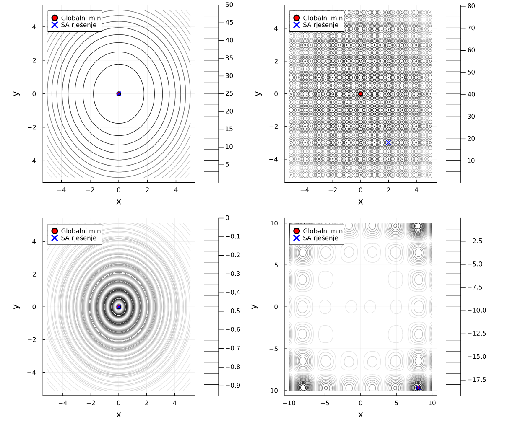
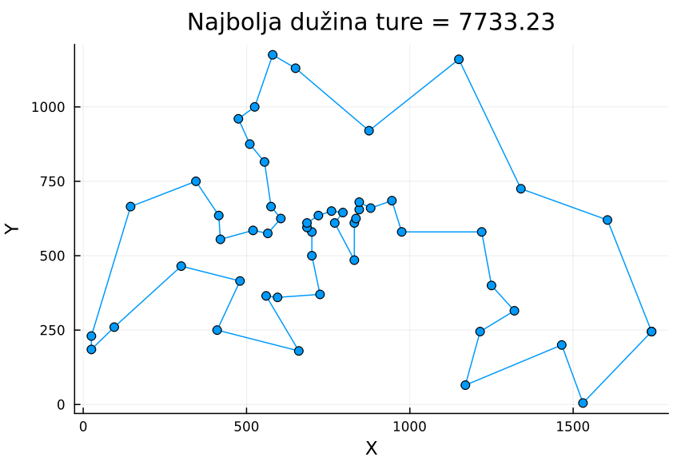

# Simulated Annealing

Seminar paper for the **Numerical Algorithms** course — Faculty of Electrical Engineering, University of Sarajevo.

An implementation of the **simulated annealing** metaheuristic in [Julia](https://julialang.org/), tested on standard benchmark functions and on the traveling salesman problem (TSPLIB instance *Berlin52*).

📄 **Full paper (in Bosnian):** [docs/Simulirano_Kaljenje.pdf](docs/Simulirano_Kaljenje.pdf)

---

## Contents

- [About the algorithm](#about-the-algorithm)
- [Repository structure](#repository-structure)
- [Running](#running)
- [Results](#results)
- [References](#references)

## About the algorithm

Simulated annealing (Kirkpatrick, Gelatt and Vecchi, 1983) is based on an analogy with the physical process of annealing: a material is heated and then cooled slowly so that it reaches a state of minimum energy.

| Physical system           | Optimization problem       |
|---------------------------|----------------------------|
| System state              | Candidate solution         |
| State energy              | Objective function value   |
| Temperature               | Control parameter $T$      |
| Global energy minimum     | Global optimum             |

**Metropolis criterion.** A better solution is always accepted; a worse one is accepted with a probability that decreases with the degradation and with the temperature:

$$
P(\text{accept } \mathbf{x}') =
\begin{cases}
1, & \Delta E < 0 \\
e^{-\Delta E / T}, & \text{otherwise}
\end{cases}
\qquad \Delta E = E(\mathbf{x}') - E(\mathbf{x})
$$

**Cooling schedule.** A geometric schedule is used: $T_{k+1} = \alpha \cdot T_k$, $\alpha \in (0, 1)$.

**Algorithm steps** (function of two variables):

1. The energy function is the objective function itself: $E(x_1, x_2) = f(x_1, x_2)$.
2. Choose an initial solution $\mathbf{x}_0$ within the domain.
3. Generate a neighbor $\mathbf{x}' = \mathbf{x} + \Delta\mathbf{x}$, $\Delta\mathbf{x} \in (-\delta, \delta)^2$, and project it onto the search range; accept it according to the Metropolis criterion.
4. Stop after $N$ iterations, or when the change in the function value drops below $\varepsilon$ (with a sufficiently low temperature).
5. Decrease the temperature and repeat from step 3.

## Repository structure

```
.
├── src/
│   └── SimulatedAnnealing.jl   # SA algorithm, test functions, TSP (2-opt)
├── scripts/
│   ├── test_funkcije.jl        # SA vs. Nelder-Mead + contour plots
│   └── tsp_berlin52.jl         # SA on the Berlin52 TSP instance
├── data/
│   └── berlin52.txt            # coordinates of 52 cities (TSPLIB)
├── docs/
│   ├── Simulirano_Kaljenje.pdf # seminar paper
│   └── images/                 # figures from the paper
└── Project.toml                # Julia dependencies
```

### Main function

```julia
SA(f, opseg, x0, delta_x, N, eps, T0; alpha=0.995) -> (x_best, f_best)
```

| Parameter | Description |
|-----------|-------------|
| `f`       | objective function of the form `f(x1, x2)` |
| `opseg`   | search range `[(xmin, xmax), (ymin, ymax)]` |
| `x0`      | starting point |
| `delta_x` | maximum step along each coordinate |
| `N`       | maximum number of iterations |
| `eps`     | minimum change of the function value between two iterations |
| `T0`      | initial temperature |
| `alpha`   | cooling factor (default `0.995`) |

Example:

```julia
include("src/SimulatedAnnealing.jl")
using .SimulatedAnnealing

x, fx = SA(holder, [(-10, 10), (-10, 10)], [9.0, -9.0], [0.5, 0.5], 50_000, 1e-8, 3.0)
```

## Running

Requires Julia 1.9 or newer. From the repository root:

```bash
julia --project=. -e "using Pkg; Pkg.instantiate()"
```

```bash
julia --project=. scripts/test_funkcije.jl
```

```bash
julia --project=. scripts/tsp_berlin52.jl
```

The scripts print results to the console and save plots and a LaTeX table to the `results/` folder.

## Results

### Benchmark functions

The algorithm was tested on four two-dimensional functions and compared with the Nelder-Mead method (`Optim.jl`, `Fminbox(NelderMead())`) started from a random point.

| Function | Formula | Global minimum |
|----------|---------|----------------|
| Paraboloid   | $x_1^2 + x_2^2$ | $f(0,0) = 0$ |
| Rastrigin    | $20 + x_1^2 - 10\cos(2\pi x_1) + x_2^2 - 10\cos(2\pi x_2)$ | $f(0,0) = 0$ |
| Drop-Wave    | $-\dfrac{1 + \cos\left(12\sqrt{x_1^2 + x_2^2}\right)}{0.5(x_1^2 + x_2^2) + 2}$ | $f(0,0) = -1$ |
| Holder Table | $-\left\lvert\sin x_1 \cos x_2 \exp\left(\left\lvert 1 - \frac{\sqrt{x_1^2+x_2^2}}{\pi}\right\rvert\right)\right\rvert$ | $f(\pm 8.055, \pm 9.6646) \approx -19.2085$ |



*Red circle — global minimum, blue cross — best SA solution.*

Deviation from the global minimum (best result per function, from the paper):

| Function     | SA                     | Nelder-Mead            |
|--------------|-----------------------:|-----------------------:|
| Paraboloid   | $1.3 \times 10^{-5}$   | $6.7 \times 10^{-10}$  |
| Rastrigin    | $16.9$                 | $43.2$                 |
| Drop-Wave    | $2.0 \times 10^{-3}$   | $0.814$                |
| Holder Table | $4.3 \times 10^{-5}$   | $11.41$                |

**Conclusion:** on a smooth, convex function Nelder-Mead is more precise, but on multimodal functions (Drop-Wave, Holder Table) SA reliably finds the global minimum while Nelder-Mead gets stuck in a local one. Rastrigin remains hard for SA with these parameters as well. The full table for all combinations of $T_0 \in \{1, 3, 5\}$ and $\alpha \in \{0.995, 0.998\}$ is in the paper.

### Traveling salesman problem — Berlin52

A configuration is a permutation of the cities, and a neighbor is obtained with a **2-opt** move (reversing a segment of the tour). Parameters: $T_0 = 1000$, $\alpha = 0.999$, $200\,000$ iterations, 30 runs.



| | Tour length |
|---|---:|
| Known optimum | 7542 |
| Best SA solution (30 runs) | 7733.23 |
| Relative error | ≈ 2.54 % |

The paper also describes applications to the knapsack problem and to neural network optimization.

## References

1. S. Kirkpatrick, C. D. Gelatt, M. P. Vecchi, *Optimization by simulated annealing*, Science 220(4598), 671–680, 1983.
2. D. Delahaye, S. Chaimatanan, M. Mongeau, *Simulated annealing: From basics to applications*, Handbook of Metaheuristics, Springer, 2018.
3. W. H. Press et al., *Numerical Recipes: The Art of Scientific Computing*, 3rd ed., Cambridge University Press, 2007.
4. S. Lin, *Computer solutions of the traveling salesman problem*, Bell System Technical Journal 44(10), 2245–2269, 1965.
5. [TSPLIB — Berlin52](https://github.com/mastqe/tsplib/blob/master/berlin52.tsp)

---

**Author:** Ahmed Spahić
